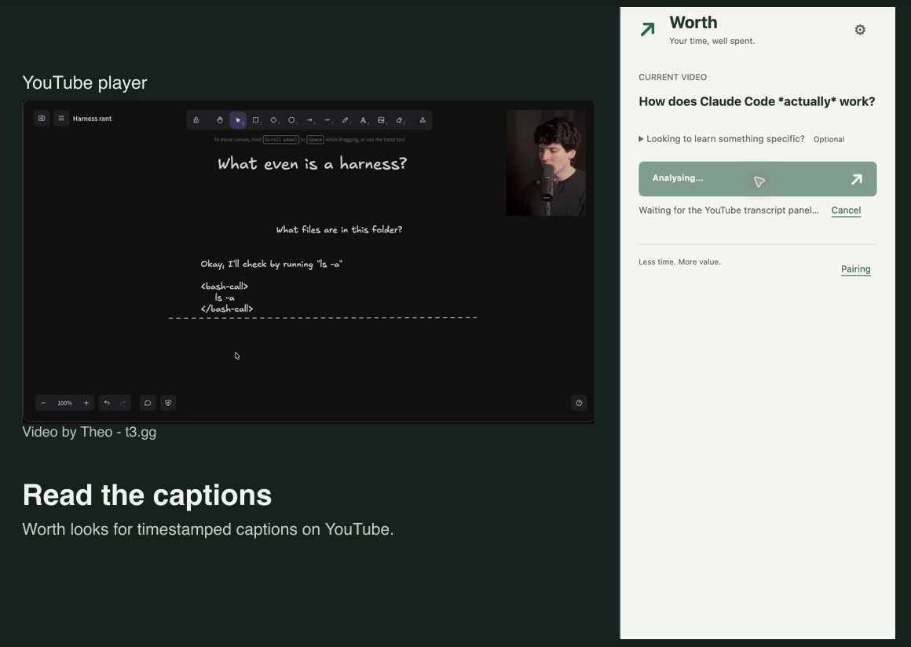
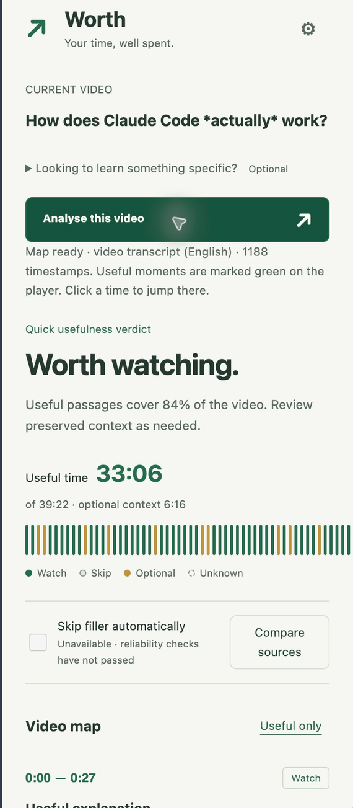
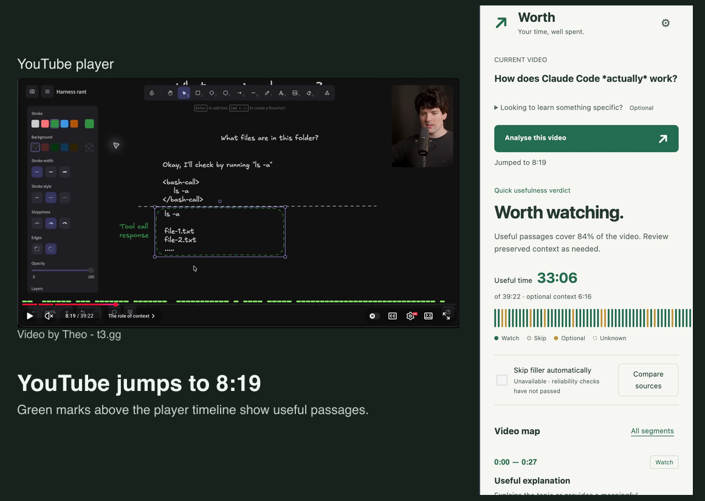

# YouTubeWorth

Worth is a Chrome extension for finding useful passages in long YouTube videos. It reads timestamped captions, builds a viewing map in Chrome's side panel, and marks suggested passages in green above the player's timeline. Click a timestamp in the panel to jump there.

**Experimental alpha (0.4.0).** Check the suggestions against the video. Worth can miss useful speech or mislabel a passage. Automatic skipping is disabled because the classifier failed its held-out evaluation.

## See it work

Worth analyses a 39-minute video, shows the viewing map, and filters it to useful passages. Clicking a passage moves the YouTube player to 8:19. The edited capture shortens processing waits.



[Watch the MP4](docs/media/demo.mp4) · [Capture notes and video credit](docs/media/README.md)

<details>
<summary>Screenshots</summary>

**Viewing map before filtering**



**Filtered map after jumping to 8:19**



</details>

## Install on an Apple Silicon Mac

You'll need Node.js 22 or newer, Python 3.12, Chrome 116 or newer, and disk space for the local model.

```sh
git clone https://github.com/faroqomar/YouTubeWorth.git
cd YouTubeWorth
python3.12 -m venv .venv
.venv/bin/python -m pip install -r requirements.lock
node download-runtime.mjs
node install-service.mjs
```

The downloader installs the pinned [Laya](https://github.com/NandhaKishorM/laya) model. The installer pairs this checkout and registers the local service with macOS. Wait for `"ready": true` before opening Worth.

```sh
curl -fsS http://127.0.0.1:4318/health
```

Open `chrome://extensions/`, enable **Developer mode**, and choose **Load unpacked**. Select the repository's `extension` folder. Worth appears in Chrome's Extensions menu. Pin it if you want it on the toolbar.

If Worth asks for pairing, open [Local setup](http://127.0.0.1:4318/setup) on the same Mac and paste its code into **Pairing** in the side panel. See the [operations guide](docs/operations.md) for service recovery and extension reloads.

## Map your first video

1. Open a regular YouTube video with captions. Click **Worth** in the Chrome toolbar or Extensions menu. The side panel starts analysing the video.
2. Once the map appears, click **Useful only** to show the passages Worth marked useful. Turn the filter off to review optional and unknown intervals.
3. Click a timestamp on a passage card. The YouTube player seeks to that time.

To focus on a topic, enter a viewing goal and click **Analyse this video** again. If Worth cannot read YouTube's captions, open **Show transcript** and retry, or import a timestamped `.srt` or `.vtt` file in the panel.

## What Worth reads

Worth classifies captions with Laya on your Mac. You don't need a cloud AI account or API key. Silent demonstrations and information shown only on screen fall outside caption analysis. Optional **Compare sources** sends search terms to Wikipedia and compares retrieved text with selected quotes on your Mac. See [privacy and limitations](docs/privacy-and-limitations.md).

Open the gear icon in the side panel to review [settings](docs/media/settings.png), including the viewing goal and player highlights.

## Development

```sh
npm test
npm run docs:check
npm run package
```

The package command builds `YouTubeWorth.zip` with the source, documentation, and curated media. Install the runtime and model separately. The archive contains an empty pairing configuration.

See the [documentation index](docs/README.md) for [architecture](docs/architecture.md), [analysis](docs/analysis.md), and [tests and evaluation](docs/testing.md). The repository has no license file.
