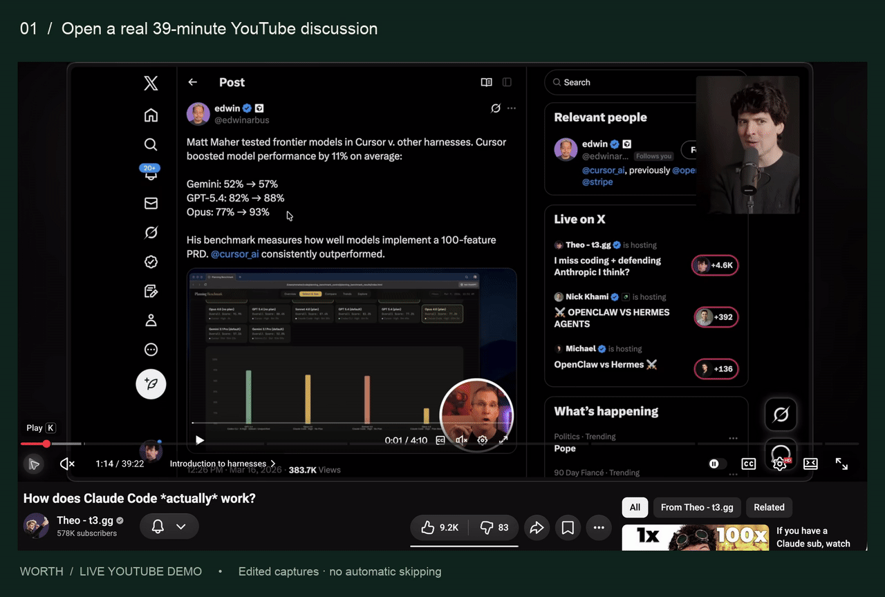
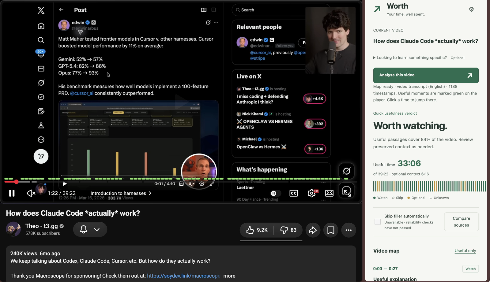
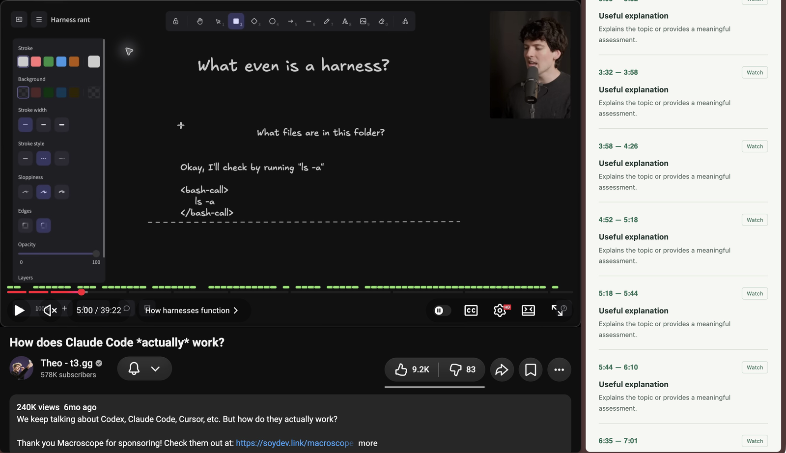
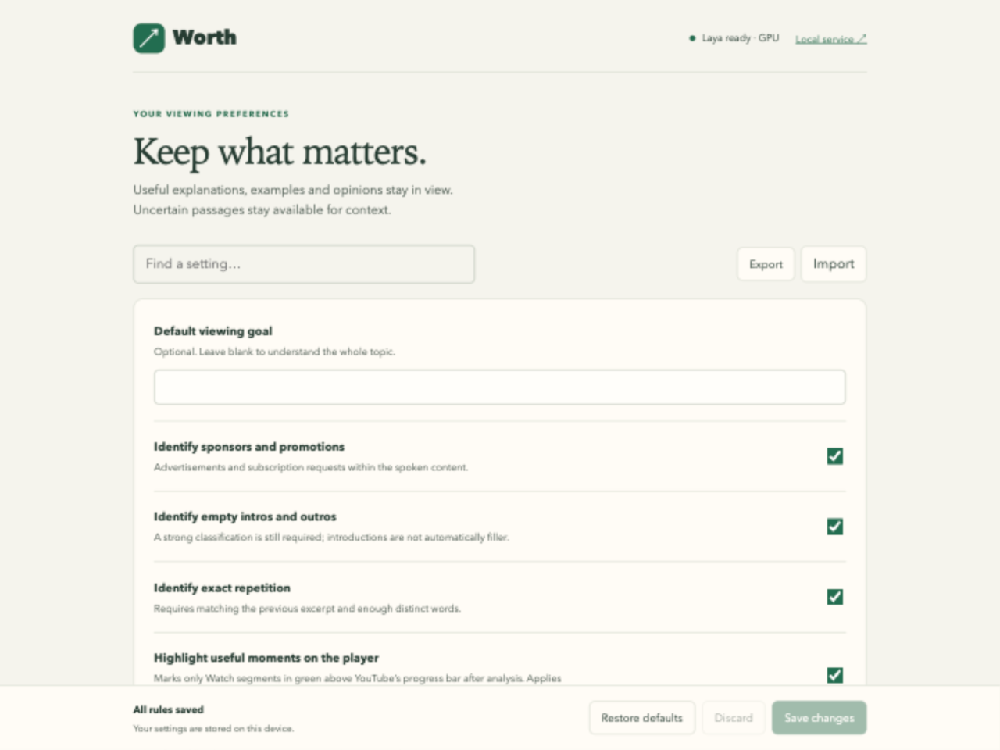

# Worth

A Chrome extension for finding useful parts of long YouTube videos. Open a video, click Worth, and review suggested passages in the side panel. Green marks above the player timeline show where they are; click a timestamp to jump there.

Worth reads captions and runs [Laya](https://github.com/NandhaKishorM/laya) on your computer. You don't need a cloud AI account or API key.

> **Experimental alpha (0.4.0).** Expect wrong labels and missed passages. Automatic skipping is disabled because the classifier failed evaluation.

## Demo



[Watch the MP4](docs/media/demo.mp4) · [Original video by Theo](https://www.youtube.com/watch?v=I82j7AzMU80)

This is the installed extension on a 39-minute video. The demo shows analysis, player highlights, filtering and a jump to 4:52. The demo skips the waits between steps. The time estimates are model suggestions.

<details>
<summary>Screenshots</summary>







</details>

## Install

You'll need **Apple Silicon macOS, Node.js 22+, Python 3.12 and Chrome 116+**, plus several GB of space for the model and dependencies. Other platforms need testing. Downloads and YouTube need internet access; model inference runs on your machine.

**1. Download and set up Worth**

Run these commands in Terminal:

```sh
git clone https://github.com/faroqomar/YouTubeWorth.git
cd YouTubeWorth
python3.12 -m venv .venv
.venv/bin/python -m pip install -r requirements.lock
node download-runtime.mjs
node install-service.mjs
```

The installer starts a local service and sets it to run at login. Keep the project folder in this location. The first model download can take a while; rerun the downloader if interrupted. You don't need `npm install` to run Worth.

**2. Check the service**

```sh
curl -fsS http://127.0.0.1:4318/health
```

Wait for `"ready":true`. If the service isn't running, open `start.command` in the project folder.

**3. Add the extension to Chrome**

1. Open `chrome://extensions/` and turn on **Developer mode**.
2. Click **Load unpacked** and select the `extension` folder inside this project.
3. Pin Worth from Chrome's Extensions menu.
4. Open a YouTube video with captions and click Worth.

If you see a pairing request, copy the code from [Local setup](http://127.0.0.1:4318/setup) into Worth's connection settings. Keep the code private.

For setup errors or service restarts, see [installation and troubleshooting](docs/operations.md).

## Using it

After analysis, click a timestamp to seek or **Useful only** to narrow the list. You can add a viewing goal before analysis, such as “understand how the database connection works.” Open **Settings** to change your preferences.

If Worth can't retrieve captions, you can import a timestamped SRT/VTT file. Without captions, it can't judge a passage. It also can't see code, diagrams or demonstrations on screen. Review the surrounding context before jumping past something.

## Development

The extension uses Chrome Manifest V3 and plain JavaScript. A Node.js HTTP service handles requests on `127.0.0.1:4318`; a Python worker runs the model. See [architecture](docs/architecture.md) for the code layout.

```sh
npm test             # Regression tests with synthetic text and controlled model output
npm run docs:check   # Check settings documentation and local links
npm run package      # Build YouTubeWorth.zip without credentials, models or runtime data
```

Additional API and browser checks need the setup described in [testing](docs/testing.md). The [verification log](docs/log/2026-11-08.md) records the tests and live YouTube checks completed on the development machine. A fresh installation on another machine still needs testing.

Keep `.local-token`, `extension/local-config.js` and `runtime/` out of commits. For data handling and evaluation results, see [privacy](docs/privacy-and-limitations.md) and [analysis](docs/analysis.md). The remaining project docs are in [docs/](docs/README.md).
